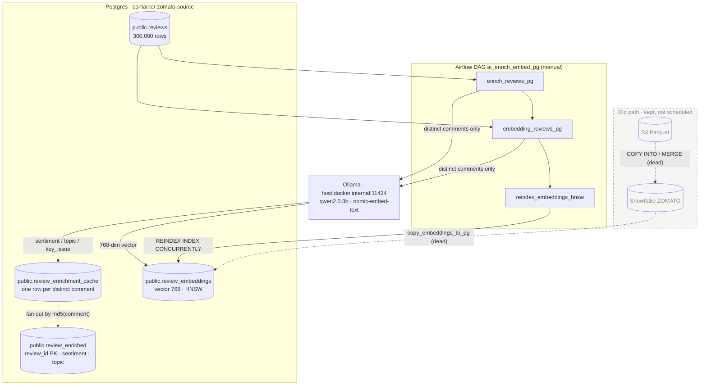

# NEWPLAN — Postgres-native enrichment + embedding

Implement the review enrichment and embedding jobs against the local pipeline Postgres
(`zomato-source`, `docker/postgres`), because the Snowflake free tier ended.
All Snowflake code and the existing `kafka_to_s3` DAG stay untouched. Airflow is **not**
started or redeployed in this change.

## 1. Why the job shape changed

`data/reviews.csv` has 300,000 reviews but only **294 distinct comment texts**. The old
Snowflake scripts made one LLM call and one embedding call **per review** (300k calls).
The Postgres jobs label/embed each **distinct comment once** and fan the result out to
every review that carries that text, so a full backfill is ~294 model calls, plus 300k
cheap `INSERT ... SELECT` rows.

This is the `REVIEW_CACHE` idea already described in `AGENTS.md`; the Snowflake code
never actually implemented it.

## 2. Files

### New files

| File | Purpose |
| --- | --- |
| `docker/airflow/dags/utils/pg.py` | Shared psycopg2 connection from `POSTGRES_*`; optional pgvector `register_vector`. |
| `docker/airflow/dags/enrich_reviews_pg.py` | Reads `public.reviews`, classifies distinct comments with Ollama, writes `public.review_enrichment_cache` + `public.review_enriched`. |
| `docker/airflow/dags/embedding_reviews_pg.py` | Reads `public.reviews`, embeds distinct comments with Ollama (`nomic-embed-text`, 768 dims), writes `public.review_embeddings` (pgvector). |
| `docker/airflow/dags/ai_enrich_embed_pg.py` | New manual DAG `ai_enrich_embed_pg`: enrich -> embed -> HNSW reindex. |
| `NEWPLAN.md` | This document. |

### Changed files

| File | Change |
| --- | --- |
| `data/ddl.sql` | Appended `public.review_enriched`, `public.review_enrichment_cache`, two label indexes, and `reviews_comment_md5_idx` on `md5(comment)`. Existing `public.review_embeddings` definition is unchanged. |

### Untouched (Snowflake stays where it is)

`docker/airflow/dags/enrich_reviews.py`, `embedding_reviews.py`, `copy_embeddings_to_pg.py`,
`pipeline.py`, `pipeline_sequential.py`, `docker/airflow/dags/sql/LANDING.*.sql`,
`zomato-dbt/`, `snowflake/`, the Airflow image and compose files.

Nothing in the old Snowflake path was deleted or rewritten, so it can be revived by
pointing the DAG back at the old modules if the warehouse comes back.

## 3. Step-by-step implementation

1. **Add the Postgres targets** in `data/ddl.sql`:
   - `public.review_enriched` — one row per review, `review_id` PK, `row_hash = md5(comment)`,
     `enriched_at` default `now()`.
   - `public.review_enrichment_cache` — one row per distinct comment, `comment_hash` PK.
   - indexes on `review_enriched(topic)`, `review_enriched(sentiment_label)`.
   - `reviews_comment_md5_idx` on `public.reviews (md5(comment))` so the per-comment
     fan-out (`WHERE md5(comment) = %s`) is an index lookup, not a 294x sequential scan.
2. **Add `utils/pg.py`** with `get_connection(register_vector_type=False)`; reads
   `POSTGRES_HOST/PORT/DB/USER/PASSWORD/SSLMODE` exactly like `copy_embeddings_to_pg.py`.
3. **Enrichment job** (`enrich_reviews_pg.py`), one loop iteration:
   1. `fan_out_from_cache()` — `INSERT INTO review_enriched SELECT ... FROM reviews JOIN
      review_enrichment_cache ON comment_hash = md5(comment)` with
      `ON CONFLICT (review_id) DO UPDATE ... WHERE row_hash IS DISTINCT FROM excluded.row_hash`.
      Covers reviews whose hash is already cached (e.g. crash between cache write and fan-out).
   2. `get_comments_to_enrich()` — distinct `md5(comment)` not yet in `review_enriched`
      and not in the cache, `LIMIT ENRICH_BATCH_SIZE` (default 500).
   3. `classify_review()` — Ollama `/api/chat` with the original JSON schema and prompt,
      3 retries with exponential backoff.
   4. `normalize_labels()` — `sentiment_label` upper-cased to `POSITIVE/NEGATIVE/NEUTRAL`
      (the dbt marts compare against uppercase literals), `sentiment_score` clamped to
      `[-1, 1]`, `topic` lower-cased and validated against the 6-topic list, blank
      `key_issue` stored as `NULL`.
   5. Upsert the fresh labels into `review_enrichment_cache`, commit, fan out, commit.
   6. Repeat until `get_comments_to_enrich()` returns nothing or `ENRICH_MAX_BATCHES` is hit.
      A batch where every comment fails stops the loop instead of spinning.
4. **Embedding job** (`embedding_reviews_pg.py`), same dedupe shape:
   1. `get_comments_to_embed()` — distinct `md5(comment)` whose reviews are missing or
      have a different `row_hash` in `public.review_embeddings`.
   2. `embed_review()` — Ollama `/api/embed`, retries, dimension check against `EMBED_DIM`.
   3. `fan_out_embedding()` — `INSERT INTO review_embeddings SELECT ... WHERE
      md5(comment) = %s ON CONFLICT (review_id) DO UPDATE ... WHERE row_hash IS DISTINCT
      FROM excluded.row_hash`, vector passed as `%s::vector(768)` through the pgvector
      adapter.
   4. Commit every `EMBED_CHUNK_COMMENTS` (default 25) comments so a crash resumes cleanly;
      the `row_hash` guard makes replays no-ops.
5. **New DAG** `ai_enrich_embed_pg.py` with `schedule=None`, `max_active_runs=1`, and
   tasks `enrich_reviews_pg >> embedding_reviews_pg >> reindex_embeddings_hnsw`.
   It imports only the new Postgres modules and the existing reindex script.
6. **Syntax check** the four new Python files with `python -m py_compile` (passed).
   No runtime test: Docker Desktop was not running and Airflow was not started.

## 4. New flow



## 5. How to run

```sh
# 1. start the pipeline Postgres only (not Airflow)
stack start postgres

# 2. apply the new tables/indexes once
docker exec -i zomato-source psql -U admin -d postgres < data/ddl.sql

# 3. enrich (host venv; 294 LLM calls)
.venv\Scripts\python.exe docker/airflow/dags/enrich_reviews_pg.py

# 4. embed (host venv; 294 embedding calls + 300k row fan-out)
.venv\Scripts\python.exe docker/airflow/dags/embedding_reviews_pg.py

# 5. optional: rebuild the HNSW index after the bulk load
.venv\Scripts\python.exe docker/airflow/dags/reindex_embeddings_hnsw.py
```

When running on the host, `.env`'s `ENRICH_BASE_URL` / `EMBED_BASE_URL` point at
`host.docker.internal`, which does not resolve from Windows. Override once for host runs:

```sh
$env:ENRICH_BASE_URL="http://localhost:11434"
$env:EMBED_BASE_URL="http://localhost:11434"
```

Inside Airflow the compose file already sets both to `host.docker.internal:11434`.

### Knobs (all optional)

| Env var | Default | Meaning |
| --- | --- | --- |
| `ENRICH_MODEL` | `qwen2.5:3b` | Ollama chat model. |
| `ENRICH_BATCH_SIZE` | `500` | Distinct comments per round. |
| `ENRICH_MAX_BATCHES` | `0` | `0` = drain everything; `1` = smoke test. |
| `EMBED_MODEL` | `nomic-embed-text` | Ollama embedding model (legacy `EMBED_MODELS` still read). |
| `EMBED_DIM` | `768` | Must match `review_embeddings.embedding`. |
| `EMBED_BATCH_SIZE` | `500` | Distinct comments per round. |
| `EMBED_CHUNK_COMMENTS` | `25` | Commit cadence during fan-out. |
| `EMBED_MAX_BATCHES` | `0` | `0` = drain everything. |

## 6. Verification

```sql
-- filled
select count(*) from public.review_enriched;             -- 300000
select count(*) from public.review_embeddings;           -- 300000
select count(distinct comment) from public.review_embeddings;  -- 294

-- every review has both, none stale
select count(*) from public.reviews r
left join public.review_enriched e using (review_id)
left join public.review_embeddings v using (review_id)
where e.review_id is null or v.review_id is null
   or e.row_hash <> md5(r.comment) or v.row_hash <> md5(r.comment);  -- 0

-- label sanity (marts expect uppercase)
select sentiment_label, count(*) from public.review_enriched group by 1 order by 2 desc;

-- vector smoke test
select review_id, comment, embedding <=> (
  select embedding from public.review_embeddings where review_id = 1
) as distance
from public.review_embeddings
order by distance
limit 5;
```

## 7. Notes and caveats

- The first embedding run will re-embed rows copied from Snowflake earlier: those have
  Snowflake's numeric `HASH()` in `row_hash`, which never equals `md5(comment)`. That is
  only 294 calls, so no migration was written.
- HNSW maintenance during the 300k-row fan-out is the slow part, not the model. The
  `ai_enrich_embed_pg` DAG reindexes after the load. For the fastest first fill, drop
  `review_embeddings_embedding_hnsw` before step 4 and recreate it afterwards with
  `reindex_embeddings_hnsw.py`; the data volume grows to roughly 3 GB either way.
- `reindex_embeddings_hnsw.py` runs `REINDEX INDEX CONCURRENTLY`, so it needs the index
  to already exist. If you drop it, recreate it with:
  `CREATE INDEX review_embeddings_embedding_hnsw ON public.review_embeddings USING hnsw (embedding vector_cosine_ops);`
- `psycopg2` and `pgvector` are present in the Airflow image (Airflow metadata DB uses
  psycopg2, `pgvector` is in the Dockerfile) and in the repo venv.
- dbt stays Snowflake-only. Moving the marts (`fct_reviews`, `mart_restaurant_sentiment`,
  `mart_review_search`) onto Postgres needs `dbt-postgres`, a Postgres profile, and
  rewritten source definitions — separate task, after the data is filled.
- `AGENTS.md` still describes the Snowflake AI path; update it when the Postgres jobs
  replace the old ones in the main DAG.
