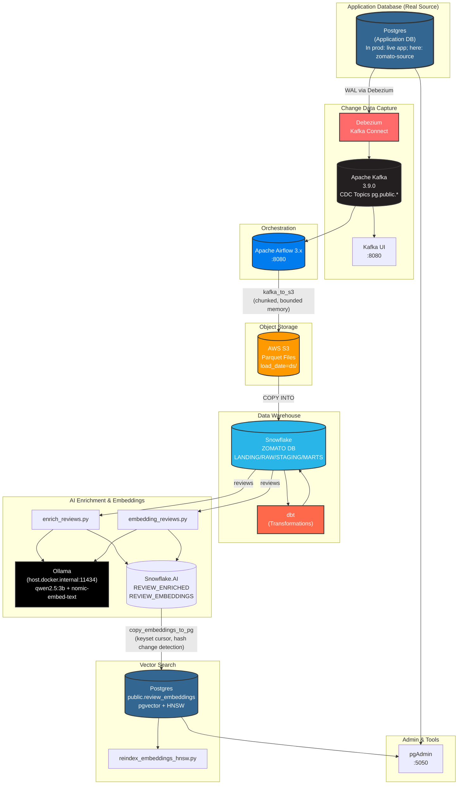
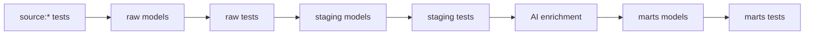

# End-to-End Food Delivery Data Pipeline

This pipeline treats an **application PostgreSQL database** as the source of truth. In production, that would be the live app DB; for this project we simulate it by loading CSVs into a local Postgres instance, then use **Debezium CDC** to stream changes to **Kafka**, land them in **S3 as Parquet**, load into **Snowflake**, transform with **dbt**, enrich with **LLMs/embeddings**, and sync vectors back to **Postgres + pgvector** for similarity search. 

## Architecture Overview




## Key Components

| Component | Technology | Purpose | Port |
|-----------|------------|---------|------|
| **Source Postgres** | PostgreSQL 17 + pgvector | Local data store, CDC source (`zomato-source`) | `5432` |
| **CDC** | Debezium + Kafka Connect | Captures row-level changes from Postgres and publishes to Kafka | `8083` |
| **Message Broker** | Apache Kafka 3.9.0 | Event streaming platform for CDC topics (`pg.public.*`) | `9092` |
| **Orchestration** | Apache Airflow 3.x | DAG orchestration for the entire pipeline | `8080` |
| **Object Storage** | AWS S3 | Landing zone for Parquet files from Kafka | - |
| **Data Warehouse** | Snowflake | Cloud data warehouse for analytics | - |
| **Transformation** | dbt | SQL-based data modeling (raw → staging → marts) | - |
| **LLM Inference** | Ollama (local) | Review enrichment (qwen2.5:3b) and embeddings (nomic-embed-text) | `11434` |
| **Vector Store** | PostgreSQL + pgvector | Semantic search store with HNSW indexing | `5432` |
| **Admin UI** | pgAdmin 4 | Database management interface | `5050` |
| **Kafka UI** | provectus/kafka-ui | Kafka topic and offset inspection | `8080` |


## Project Structure

```
end-to-end-data-pipeline/
├── data/                      # Source data and ingestion
│   ├── *.csv                  # Raw CSV files (gitignored, ~34M rows)
│   ├── ddl.sql                # PostgreSQL schema definition
│   ├── import_data.py         # Bulk CSV loader
│   ├── verify_data.py         # Data validation
│   └── ERD.md                 # Entity relationship diagram
├── docker/                    # Containerized services
│   ├── airflow/               # Airflow setup
│   │   ├── dags/              # DAG definitions and Python modules
│   │   │   ├── pipeline.py           # Main DAG: kafka_to_s3
│   │   │   ├── pipeline_sequential.py # Sequential variant
│   │   │   ├── kafka_export.py       # Kafka to S3 exporter
│   │   │   ├── enrich_reviews.py     # LLM review enrichment
│   │   │   ├── embedding_reviews.py  # Vector embedding generation
│   │   │   ├── copy_embeddings_to_pg.py # Snowflake→Postgres sync
│   │   │   ├── reindex_embeddings_hnsw.py # HNSW index maintenance
│   │   │   └── sql/                 # SQL for Snowflake operations
│   │   └── Dockerfile
│   ├── postgres/              # Source Postgres with pgvector
│   ├── kafka-debezium/        # Kafka, Zookeeper, Connect, Debezium
│   └── pgadmin/               # pgAdmin setup
├── snowflake/                 # Snowflake setup scripts
├── src/                       # Python package scaffold
├── zomato-dbt/                # dbt project
│   ├── models/
│   │   ├── raw/               # Raw layer (from Snowflake COPY)
│   │   ├── staging/           # Staging transformations
│   │   └── marts/             # Business logic marts
│   └── profiles.yml
├── .env                       # Environment variables (gitignored)
├── AGENTS.md                  # Agent/contributor guidelines
└── README.md                  # This file
```


## Real Source vs Demo Data

- **Real scenario:** The application writes directly to its own PostgreSQL database. **Debezium reads the WAL** of that production/application DB and streams changes via CDC. The DB is the "source of truth"; no CSV import in production.
- **This project (demo):** To simulate a real application DB, we bulk-load CSVs into a local Postgres container (`zomato-source`). From that point onward, **the pipeline treats Postgres as the CDC source** (same flow as production). The only difference is the one-time bulk load — everything downstream (Debezium/Kafka/Airflow/S3/Snowflake/dbt/AI) is production-aligned.

### 3. Kafka → S3 (Streaming Export)
The `kafka_to_s3` DAG exports CDC data to S3 with memory-safe chunking:

- **Per-partition workers**: Process each Kafka partition independently
- **Bounded memory**: Chunks capped by `CHUNK_MAX_RECORDS` (50k) and `CHUNK_MAX_BYTES` (32MB)
- **Backpressure**: Bounded queue prevents OOM (reader blocks when queue full)
- **At-least-once delivery**: Offsets committed only after successful S3 upload
- **Retry-safe**: S3 keys include offset ranges, retries overwrite same objects
- **Parquet output**: `s3://<bucket>/<table>/load_date=<ds>/<table>-p<partition>-o<start>-<end>.parquet`

### 4. S3 → Snowflake (Loading)
Per table in the DAG:
1. **Wait**: `S3KeySensor` waits for Parquet files
2. **COPY**: Load into `ZOMATO.RAW.<table>_raw` (partition cleared first)
3. **MERGE**: Deduplicate by latest event (`__source_ts_ms DESC`) and merge into target table
   - `op='d'` + newer timestamp → delete
   - newer timestamp → update
   - else → insert (including `op='r'` upserts)

### 5. dbt Transformations


### 6. AI Enrichment & Embeddings
- **Review Enrichment** (`enrich_reviews.py`): Uses LLM (qwen2.5:3b via Ollama) to classify/summarize reviews into `ZOMATO.AI.REVIEW_ENRICHED`
- **Caching**: `REVIEW_CACHE` keyed by comment hash to avoid redundant API calls
- **Embeddings** (`embedding_reviews.py`): Generates 768-dim vectors with `nomic-embed-text` into `ZOMATO.AI.REVIEW_EMBEDDINGS` (MERGE on `REVIEW_ID`, re-embeds only on hash change)
- **Sync to Postgres** (`copy_embeddings_to_pg.py`): Keyset-cursor incremental sync from Snowflake to `public.review_embeddings` with hash-based change detection
- **Index Maintenance** (`reindex_embeddings_hnsw.py`): Rebuilds HNSW index after updates to clean dead nodes


## Getting Started

### Prerequisites
- Docker Desktop
- Python 3.11+ with venv
- AWS credentials (for S3)
- Snowflake credentials
- Ollama (for local LLM/embeddings)

### Setup

1. **Clone and configure environment**
```bash
cp .env.example .env  # Edit with your credentials
```

2. **Start infrastructure**
```bash
# Start all services
cd docker/postgres && docker compose --env-file ../../.env up -d
cd docker/kafka-debezium && docker compose --env-file ../../.env up -d
cd docker/airflow && docker compose --env-file ../../.env up -d
cd docker/pgadmin && docker compose --env-file ../../.env up -d
```

3. **Load initial data into Postgres**
```bash
.venv\Scripts\python.exe data/import_data.py --create  # Load all 7 tables
```

4. **Setup Debezium connector**
The connector config is in `docker/kafka-debezium/zomato-source.json`. The `connect-init` service should auto-register it.

5. **Run Airflow DAGs**
```bash
# Setup Snowflake (first time)
docker exec airflow-scheduler-1 airflow dags trigger snowflake_setup

# Run the full pipeline
docker exec airflow-scheduler-1 airflow dags trigger kafka_to_s3 --logical-date $(date +%Y-%m-%d)
```

### Local Development
- **Postgres UI**: http://localhost:5050 (pgAdmin)
- **Airflow UI**: http://localhost:8080 (admin/admin)
- **Kafka UI**: http://localhost:8080 (provectus kafka-ui)

## Configuration

All credentials are loaded from `.env` (repo root, gitignored):

| Category | Variables |
|----------|-----------|
| **Postgres** | `POSTGRES_HOST`, `POSTGRES_PORT`, `POSTGRES_DB`, `POSTGRES_USER`, `POSTGRES_PASSWORD`, `POSTGRES_SSLMODE` |
| **Snowflake** | `SNOWFLAKE_ACCOUNT`, `SNOWFLAKE_USER`, `SNOWFLAKE_PASSWORD`, `SNOWFLAKE_WAREHOUSE`, `SNOWFLAKE_DATABASE` |
| **AWS/S3** | `AWS_ACCESS_KEY_ID`, `AWS_SECRET_ACCESS_KEY`, `AWS_DEFAULT_REGION`, `S3_BUCKET` |
| **Kafka** | `KAFKA_BOOTSTRAP_SERVERS`, `KAFKA_GROUP_ID` |
| **LLM** | `ENRICH_BASE_URL`, `ENRICH_MODELS`, `ENRICH_WORKERS`, `ENRICH_BATCH_SIZE` |
| **Embeddings** | `EMBED_BASE_URL`, `EMBED_MODELS`, `EMBED_DIM`, `EMBED_WORKERS`, `EMBED_BATCH_SIZE` |

## Key Features

- **Memory-safe CDC export**: Chunked streaming prevents OOM on large partitions
- **Exactly-once semantics**: Offset commits only after successful uploads
- **Idempotent operations**: All loads and merges are safe to re-run
- **Incremental AI processing**: Hash-based caching prevents redundant LLM/embedding calls
- **Efficient vector sync**: Keyset pagination with hash-change detection avoids unnecessary updates
- **HNSW index maintenance**: Automated reindexing after vector updates
- **Logical relationships**: No foreign keys in source, relationships modeled in dbt


## Notes

- **Data size**: ~34M rows total across 7 tables, ~4GB in CSVs
- **Postgres migration**: Moved from Supabase to local Dockerized Postgres due to size limits
- **Debezium numerics**: Decoded from base64 two's-complement in `kafka_export.py`
- **Ollama networking**: Must listen on `0.0.0.0` for containers to reach via `host.docker.internal:11434`
- **Manual triggers**: All DAGs use `schedule=None` for controlled execution
```