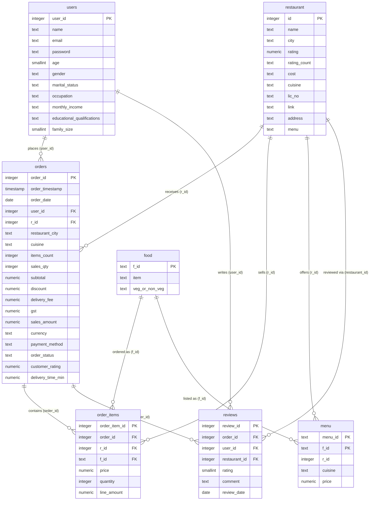

# Food-Delivery Dataset — ERD

Source of truth for this diagram: [`data/ddl.sql`](./ddl.sql). Relationships are **logical**
(from the dataset's shared keys) — the DDL declares **no `FOREIGN KEY` constraints**; only the
primary keys below are enforced.

## Relationships

| # | From | To | Cardinality | Via | Notes |
|---|------|----|-------------|-----|-------|
| 1 | `users` | `orders` | 1 : N | `users.user_id = orders.user_id` | |
| 2 | `users` | `reviews` | 1 : N | `users.user_id = reviews.user_id` | |
| 3 | `restaurant` | `orders` | 1 : N | `restaurant.id = orders.r_id` | |
| 4 | `restaurant` | `order_items` | 1 : N | `restaurant.id = order_items.r_id` | denormalized onto the line |
| 5 | `restaurant` | `menu` | 1 : N | `restaurant.id = menu.r_id` | `menu_id` maps to exactly one restaurant |
| 6 | `restaurant` | `reviews` | 1 : N | `restaurant.id = reviews.restaurant_id` | |
| 7 | `food` | `order_items` | 1 : N | `food.f_id = order_items.f_id` | |
| 8 | `food` | `menu` | 1 : N | `food.f_id = menu.f_id` | |
| 9 | `orders` | `order_items` | 1 : N | `orders.order_id = order_items.order_id` | |
| 10 | `orders` | `reviews` | 1 : N | `orders.order_id = reviews.order_id` | |

## Notes

- **Raw CSV sizes** (rows): `orders` 10,000,000 · `order_items` 22,998,179 · `menu` 1,179,936 ·
  `food` 371,561 · `reviews` 300,000 · `restaurant` 148,541 · `users` 100,000.
- **Loaded into local Postgres** (`docker/postgres`): all 7 tables — `users`, `restaurant`,
  `food`, `menu`, `orders`, `order_items`, `reviews`. The earlier hosted Supabase project was
  too small (~1 GB limit; loading `orders` flipped it read-only), so the pipeline now runs
  against the Dockerized Postgres, which has the disk for the full ~34M rows.
- **Primary keys** were verified against the source CSVs: `user_id`, `restaurant.id`, `f_id`,
  `order_id`, `order_item_id`, `review_id` are unique; `menu` uses the composite
  `(menu_id, f_id)` (neither column is unique alone).
- **`menu`** carries a denormalized `r_id`; `menu_id` never spans more than one restaurant.
- **Typing quirks**:
  - `restaurant.rating` uses `'--'` for "too few ratings" → loaded as `NULL`.
  - `restaurant.rating_count` is text (`'50+ ratings'`, `'Too Few Ratings'`).
  - `restaurant.cost` is text (`'₹ 1 200'`).
  - `restaurant.lic_no` is text (keeps leading digits / avoids numeric overflow).
  - `menu.price` is dirty: 1,193 rows carry values like `'₹200 FOR TWO'`; the loader
    extracts the number (→ `200`).
- An unnamed leading index column exists in `users`, `restaurant`, `food`, `menu`; the loader
  drops it. Column names with spaces are mapped to snake_case on import
  (see `data/import_data.py`).
- Re-load cleanly with `python data/import_data.py --create --truncate` (all 7 tables; use
  `--only <table>` to load a subset).