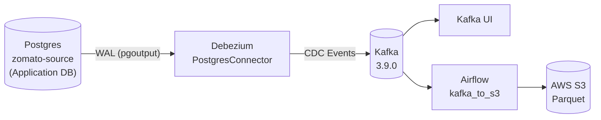

# Kafka & Debezium in This Project

## Overview

This project uses **Debezium** with **Kafka Connect** to capture change data from the PostgreSQL application database (`zomato-source`) and stream it to **Apache Kafka**. From there, **Airflow** consumes those CDC events and exports them as Parquet to **AWS S3** for loading into **Snowflake**.

## Architecture



## Debezium Configuration

The connector is defined in `docker/kafka-debezium/zomato-source.json`:

```json
{
  "name": "zomato-source",
  "config": {
    "connector.class": "io.debezium.connector.postgresql.PostgresConnector",
    "database.hostname": "${env:POSTGRES_HOST}",
    "database.port": "${env:POSTGRES_PORT}",
    "database.user": "${env:POSTGRES_USER}",
    "database.password": "${env:POSTGRES_PASSWORD}",
    "database.dbname": "${env:POSTGRES_DB}",
    "topic.prefix": "pg",
    "plugin.name": "pgoutput",
    "slot.name": "debezium_zomato",
    "publication.autocreate.mode": "filtered",
    "table.include.list": "public.menu,public.orders,public.users,public.restaurant,public.reviews,public.food,public.order_items",
    "snapshot.mode": "initial",
    "transforms": "unwrap",
    "transforms.unwrap.type": "io.debezium.transforms.ExtractNewRecordState",
    "transforms.unwrap.add.fields": "op,source.ts_ms",
    "transforms.unwrap.delete.handling.mode": "rewrite",
    "key.converter": "org.apache.kafka.connect.json.JsonConverter",
    "value.converter": "org.apache.kafka.connect.json.JsonConverter",
    "key.converter.schemas.enable": "false",
    "value.converter.schemas.enable": "false"
  }
}
```

### Key Settings Explained

| Setting | Value | Explanation |
| --- | --- | --- |
| `connector.class` | `io.debezium.connector.postgresql.PostgresConnector` | Uses Debezium's PostgreSQL connector. |
| `topic.prefix` | `pg` | Topics are created as `pg.public.<table>`. |
| `plugin.name` | `pgoutput` | Uses PostgreSQL's built-in logical decoding output plugin (no extra plugin required). |
| `slot.name` | `debezium_zomato` | Replication slot used to track WAL position. |
| `publication.autocreate.mode` | `filtered` | Creates a publication only for tables in `table.include.list`. |
| `table.include.list` | `public.menu,...,public.order_items` | Only these 7 tables are captured. |
| `snapshot.mode` | `initial` | On first start, takes a consistent snapshot of included tables, then streams changes. |
| `transforms.unwrap` | `ExtractNewRecordState` | Flattens Debezium's envelope to just the row data, making it easier for consumers. |
| `transforms.unwrap.add.fields` | `op,source.ts_ms` | Adds operation type (`r`/`c`/`u`/`d`) and source timestamp to each record. |
| `transforms.unwrap.delete.handling.mode` | `rewrite` | Rewrites deletes as tombstones/records so downstream can handle them. |
| `key/value.converter` | `JsonConverter` (schemas disabled) | Uses plain JSON without schema registry for simplicity in this project. |

## Kafka Topics

With `topic.prefix=pg`, Debezium creates one topic per captured table:

| Topic | Table | Purpose |
| --- | --- | --- |
| `pg.public.users` | `public.users` | User accounts |
| `pg.public.restaurant` | `public.restaurant` | Restaurants |
| `pg.public.food` | `public.food` | Food items |
| `pg.public.menu` | `public.menu` | Restaurant menus |
| `pg.public.orders` | `public.orders` | Orders |
| `pg.public.order_items` | `public.order_items` | Order line items |
| `pg.public.reviews` | `public.reviews` | Customer reviews |

## Sample CDC Event Data

After `ExtractNewRecordState`, a message looks like a flattened JSON object with the table row plus metadata fields added by the transform.

### Insert (`op: "c"`) Example - `pg.public.orders`

```json
{
  "order_id": 1234567,
  "order_timestamp": 1712345678000,
  "order_date": 19750,
  "user_id": 42,
  "r_id": 15,
  "restaurant_city": "Mumbai",
  "cuisine": "Indian",
  "items_count": 2,
  "sales_qty": 2,
  "subtotal": "500.00",
  "discount": "50.00",
  "delivery_fee": "30.00",
  "gst": "24.00",
  "sales_amount": "504.00",
  "currency": "INR",
  "payment_method": "UPI",
  "order_status": "DELIVERED",
  "customer_rating": "5.0",
  "delivery_time_min": "35",
  "__op": "c",
  "__source_ts_ms": 1712345680123
}
```

### Update (`op: "u"`) Example - `pg.public.reviews`

```json
{
  "review_id": 98765,
  "order_id": 1234567,
  "user_id": 42,
  "restaurant_id": 15,
  "rating": 5,
  "comment": "Great food!",
  "review_date": 19750,
  "__op": "u",
  "__source_ts_ms": 1712345700456
}
```

### Delete (`op: "d"`) Example - `pg.public.order_items`

```json
{
  "order_item_id": 555444,
  "order_id": 1234567,
  "r_id": 15,
  "f_id": "F123",
  "price": "250.00",
  "quantity": 1,
  "line_amount": "250.00",
  "__op": "d",
  "__source_ts_ms": 1712345720789
}
```

> **Note:** With `delete.handling.mode: "rewrite"`, deletes are still emitted as records with `__op: "d"`. The downstream logic (Snowflake MERGE) uses `__op` and `__source_ts_ms` to determine deletes/updates/inserts.

## How This Project Uses Kafka/Debezium

### Infrastructure (Docker)
Located in `docker/kafka-debezium/`:
- **Kafka broker** (3.9.0)
- **Kafka Connect** with Debezium PostgreSQL connector
- **Kafka UI** for inspecting topics/messages
- **connect-init** to register the connector from `zomato-source.json`

### Consumption (Airflow)
In `docker/airflow/dags/kafka_export.py` and `pipeline.py`:

1. **KafkaConsumer** reads from topics `pg.public.<table>` with group ID `airflow-kafka-to-s3`
2. **Chunking**: Events are batched by `CHUNK_MAX_RECORDS` and `CHUNK_MAX_BYTES` with bounded queues to control memory
3. **Numeric decoding**: Debezium serializes `numeric` types as base64 (two's-complement big-endian) — `kafka_export.py` decodes them back to `Decimal` for correct Parquet typing
4. **Parquet writing**: Chunks are written to S3 as `s3://<bucket>/<table>/load_date=<ds>/<table>-p<partition>-o<start>-<end>.parquet`
5. **Offset commits**: Offsets are only committed after successful S3 upload (at-least-once delivery)

### Loading to Snowflake
The `kafka_to_s3` DAG per table:
1. `consume_<table>_to_s3` → exports CDC events to S3
2. `wait_<table>` → waits for Parquet files via `S3KeySensor`
3. `merge_<table>_to_snowflake` → runs `docker/airflow/dags/sql/LANDING.<table>.sql` to `COPY INTO` then merge based on `__source_ts_ms` and `__op`

## Useful Commands

```bash
# Check connector status
curl http://localhost:8083/connectors/zomato-source/status

# List topics
docker exec kafka kafka-topics --bootstrap-server kafka:9092 --list | grep pg.public

# Inspect messages for a topic
docker exec kafka kafka-console-consumer --bootstrap-server kafka:9092 --topic pg.public.orders --from-beginning --max-messages 5
```

## Note

### Debezium Numeric Serialization

Debezium's PostgreSQL connector represents `NUMERIC`/`DECIMAL` values as base64-encoded strings (unscaled big-endian two's complement) in the Kafka messages, rather than JSON numbers. This is to preserve exact precision for arbitrary-precision decimals.

#### Why base64?

- JSON does not have native arbitrary-precision decimal types (JavaScript `number` is IEEE 754 double). Large or high-precision `NUMERIC` values can lose precision if serialized as floats.
- Base64 of the binary unscaled value (big-endian, two's complement) preserves exact precision.
- Debezium uses this format consistently so consumers can reconstruct the exact decimal.

#### Sample encode (conceptual)

For example, `12.50` with scale `2` means unscaled value `1250`. As big-endian two's complement bytes: `0x04 0xE2`. Base64-encoded, this becomes `"BOI="`.

Kafka event (as emitted by Debezium before unwrapping):
```json
{
  "payload": {
    "after": {
      "subtotal": "BOI=",
      ...
    }
  }
}
```

After `ExtractNewRecordState` transform (our connector unwraps), the flattened record still carries the base64 string for numeric columns:
```json
{
  "subtotal": "BOI=",
  "discount": "32s=",
  ...
}
```

#### Decoding in this project

In this project, we decode these base64 `NUMERIC` values **before writing Parquet to S3** in `docker/airflow/dags/kafka_export.py` (see `decode_numerics()` / `_decode_numeric()`):

```python
def _decode_numeric(value: str | None, scale: int) -> Decimal | None:
    if value is None or not isinstance(value, str):
        return value
    bytes = base64.b64decode(value)
    unscaled = int.from_bytes(bytes, byteorder="big", signed=True)
    return Decimal(unscaled).scaleb(-scale)

def decode_numerics(table: str, rows: list) -> list:
    columns = NUMERIC_COLUMNS.get(table)
    if not columns:
        return rows
    for row in rows:
        for column, scale in columns.items():
            if column in row:
                row[column] = _decode_numeric(row[column], scale)
    return rows
```

Tables/columns with scales are defined in `NUMERIC_COLUMNS` (e.g., `orders.subtotal/discount/delivery_fee/gst/sales_amount` scale 2, `restaurant.rating` scale 1, etc.).

#### Sample decode

- Input: `"BOI="`, scale `2` → unscaled `1250` → `Decimal('1250').scaleb(-2)` → `Decimal('12.50')`
- Output in Parquet: exact decimal `12.50` (preserved via PyArrow `decimal128`/logical decimal), not a float string

#### Why I decode before saving to S3?

- **Future-proof interoperability**: Storing decoded decimals in Parquet means downstream consumers (Spark, Athena, Trino/Presto, Snowflake external tables, dbt, etc.) can read proper decimal/numeric types without needing Debezium-specific decoding logic.
- **Cleaner data contracts**: The S3 "landed" data is in business-native types, not a Debezium serialization detail.
- **Correct comparisons/aggregations**: Downstream tools will do decimal arithmetic correctly (sum/avg) without string parsing hacks.
- **Snowflake COPY reads Parquet decimals directly**: My `COPY INTO` from Parquet reads typed values; having correct logical types avoids implicit coercions and makes the pipeline reusable for other consumers.

In short: Debezium uses base64 to safely serialize arbitrary precision; I normalize to actual `Decimal` values before writing to S3 so the Parquet files are portable, self-describing, and correctly typed for any downstream engine.

