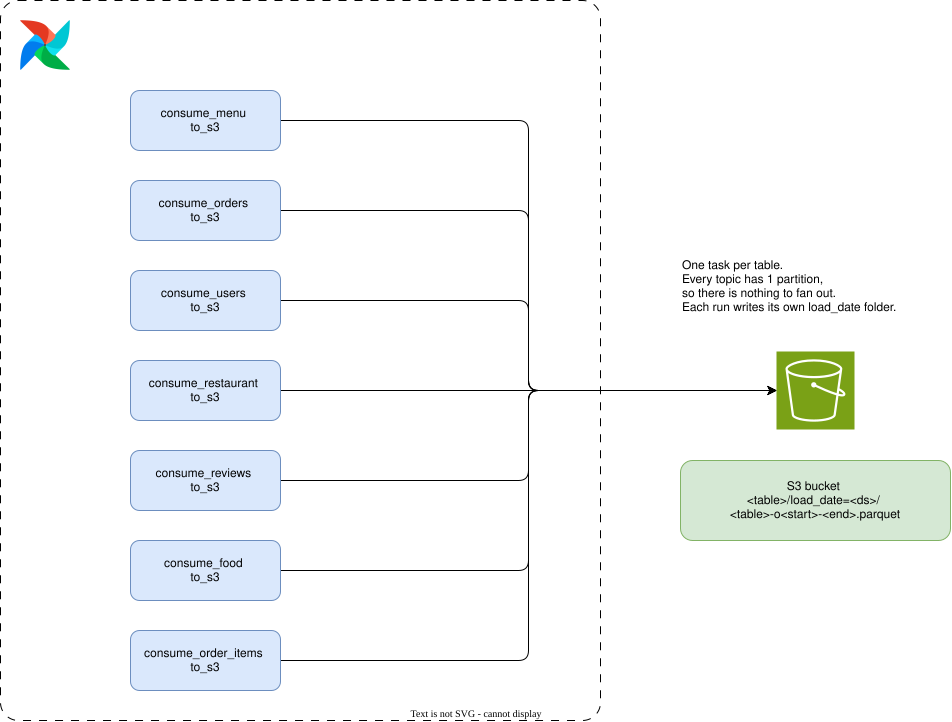
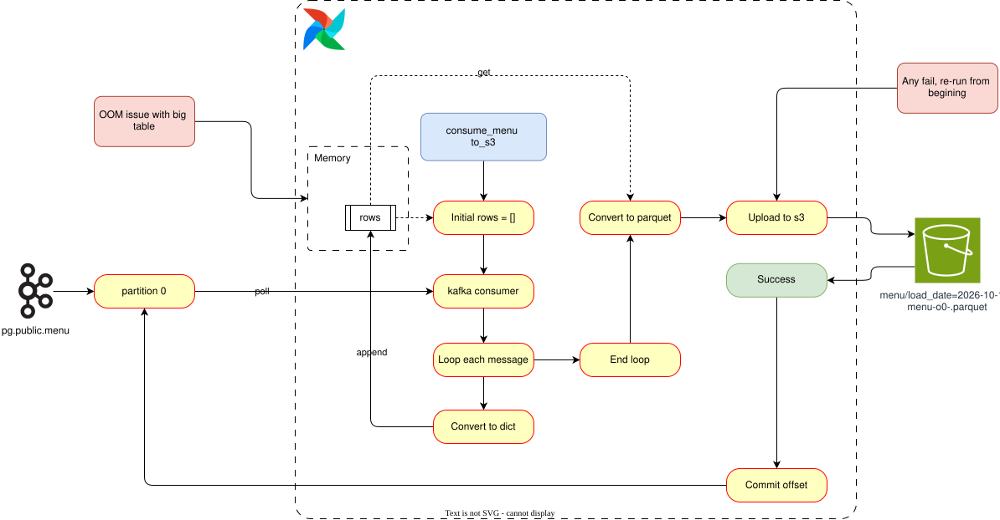

# Kafka → S3 Export — Phase 1 (v1)

## Overview

First working version of the Kafka → S3 landing step. **The goal of this step is only to move the
CDC events from Kafka to S3 as Parquet.** Nothing else — no Snowflake load, no dbt, no
transformation.

One Airflow task per table, each running `kafka_export.export_parallel(table, ds)` against **one
Kafka partition per topic**, writing **one Parquet object per table per run**.

| Property | Phase 1 |
| --- | --- |
| Partitions per topic | **1** (Debezium default, no per-topic partition config) |
| Tasks per table | 1 (`consume_<table>_to_s3`) |
| Chunking | **none** — the partition is drained in one pass |
| S3 objects per table per run | 1 |
| Commit | once, after the S3 write succeeds |
| Concurrency | 7 table tasks in parallel |

Diagrams (editable `.drawio.svg` — the picture and the diagram XML in one file, so they open in
draw.io as-is): [`airflow.drawio.svg`](diagrams/airflow.drawio.svg) for the Airflow run and
[`kafka-export-v1.drawio.svg`](diagrams/kafka-export-v1.drawio.svg) for one table's export flow.
The `.drawio` files next to them are the editing sources; `docs/diagrams/build_svg.py` regenerates
the SVG from a `.drawio` page.

## Sample parallel Airflow run

All 7 tasks start at the same time. Each drains its own topic and writes its own Parquet object
under its own `load_date` prefix. There is no dependency between them.



*Source: [`airflow.drawio`](diagrams/airflow.drawio) — page 1.*

## The export function, phase 1

One table shown (`menu`); the other six run the exact same flow in parallel. No numeric decoding
here — that was added later.



*Source: [`kafka-export-v1.drawio`](diagrams/kafka-export-v1.drawio) — page 1.*

## Why a `load_date` folder per run

The DAG is meant to run **once a day**, and CDC is **incremental** — each run only carries what
changed since the last committed offset. So every run writes into its own
`load_date=<ds>/` prefix instead of appending to one growing file per table.

- **Trackable** — "what did the pipeline land on 2026-11-01?" is one prefix listing, not a diff of
  a 20 GB object.
- **Maintainable** — a bad day is re-run or deleted without touching the other days, and a backfill
  lands in the folder it belongs to.
- **Idempotent** — re-running the same `ds` overwrites `<table>-o<start>-<end>.parquet`, so a
  retry never leaves two copies of the same offset range.

## Key mechanisms

### 1) One partition, one consumer, one file

Each topic has a single partition, so there is nothing to fan out. The consumer is assigned
explicitly (`assign([tp])`) instead of joining a consumer group, which keeps the offset under this
task's control.

### 2) Whole partition in memory

Records are appended to a Python list until the partition is drained. Nothing goes to S3 until the
end of the run, so peak memory is proportional to the table size, not to a chunk size. Fine for
`users` (100k rows), a problem for `order_items` (23M rows).

### 3) Debezium numeric decoding

Debezium ships `NUMERIC/DECIMAL` as base64. `decode_numerics()` rewrites those columns to `Decimal`
before Parquet is written, otherwise the values land as opaque strings.

### 4) Parquet output key

```
s3://<bucket>/<table>/load_date=<ds>/<table>-o<start>-<end>.parquet
```

No partition suffix — phase 1 has exactly one partition, so `-p0` would be noise. The offset range
stays in the name because it makes the write idempotent.

### 5) Manual commit, only after the file is in S3

`enable_auto_commit=False`. The offset is committed once, after the Parquet object exists in S3.
A crash before that commit records nothing as processed, and re-running the task is safe:

- the consumer re-reads from the **last committed offset**, so the same records come back;
- the same `start`/`end` offsets produce the **same S3 key**;
- `put_object` overwrites that object, so the retry leaves **no duplicate file**.

So "failed → just run the job again" is a supported recovery path, not a cleanup chore. The same
property makes the daily incremental design work: each run starts where the previous commit
stopped and writes into that day's prefix.

The catch: that safety is **all-or-nothing per table**. One commit at the end means one failure
costs the entire table. See the problem section below.

### 6) Upload retry

`put_object` retries with exponential backoff (`UPLOAD_BACKOFF_BASE_S * 2^(attempt-1)`) up to
`UPLOAD_MAX_RETRIES`, so a transient S3 error does not kill a long export.

## Known problem — slow, and a retry costs the same as the first run

| Table | Rows | Duration | Status |
| --- | ---: | ---: | --- |
| `users` | 100,000 | ~15 s | modelled |
| `restaurant` | 148,541 | ~20 s | modelled |
| `reviews` | 300,000 | ~40 s | modelled |
| `food` | 371,561 | ~45 s | modelled |
| `menu` | 1,179,936 | ~2 min | modelled |
| **`orders`** | 10,000,000 | **~25 min** | **measured** |
| `order_items` | 22,998,179 | not measured — worse than `orders` | — |

The real problem is not the 25 minutes. It is that the 25 minutes is **all-or-nothing**:

- the commit happens only after the last record is in S3, so any failure re-reads the table from
  offset 0 — a retry is never cheaper than the first attempt;
- nothing is uploaded until the whole partition is in memory, so the slow part (polling Kafka) and
  the expensive part (JSON decode + Parquet write + upload) never overlap.

### `order_items` does not fit in memory at all

23M rows sit in one Python list, and then `pa.Table.from_pylist` builds the Arrow table on top of
it — roughly double the footprint. That run was **OOM-killed**. Draining all 7 tables at once also
took `kafka` and `connect` down with it, because everything shares one Docker host.

The mitigation at the time was the sequential DAG (`kafka_to_s3_sequential`, `max_active_tasks=1`,
one table at a time). It survives, but it is slower and still has no checkpointing: a failure at
90% of `order_items` throws away the whole run.

So phase 1 fails two ways, same root cause — no chunking:

| Symptom | Cause |
| --- | --- |
| `orders` takes ~25 min | single-threaded decode + Parquet write, upload serialised after the drain |
| `order_items` OOM-killed | whole partition in RAM, doubled by `pa.Table.from_pylist` |
| re-run costs the same as the first run | one commit, at the very end |

Enhancements for phase 2:

1. **Chunking** — bound the buffer by records or bytes instead of the whole partition.
2. **Commit per chunk** — a failure costs one chunk, and a re-run resumes from the last landed
   chunk instead of the beginning.
3. **Reader thread + uploader threads** — uploads overlap with polling instead of serialising after
   the drain.

Also worth profiling: single-threaded JSON decode plus `pa.Table.from_pylist` is the likely hot
spot, so the biggest win may come from parallelising the transform, not just the upload.

Phase 2 write-up: [`docs/Kafka-Parallel-Export.md`](Kafka-Parallel-Export.md).
