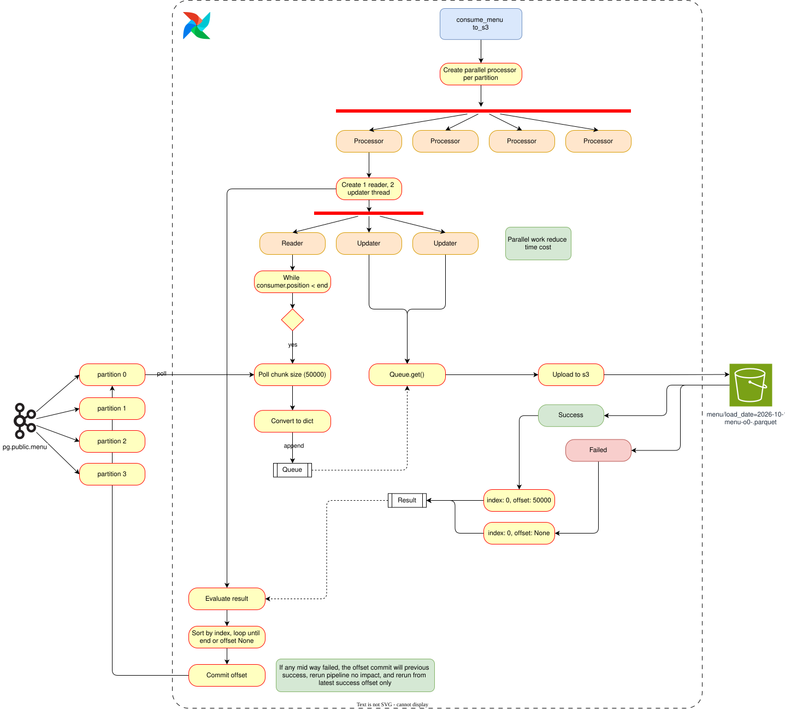

# Parallel Kafka → S3 Export (v2)

## Overview

In this project, I export CDC events from Kafka topics to S3 as Parquet in parallel while keeping memory bounded. Each Airflow task runs `kafka_export.export_parallel(table, ds)`, which spawns **one process per Kafka partition** (capped by a local-machine limit) and processes partitions concurrently. Within each partition, a single consumer reads the partition, accumulates bounded chunks, uploads each chunk to S3 immediately, and commits the Kafka offset after every successful chunk — never buffering a whole partition in memory.

This is the **Step 8** rewrite of the original v1 export. It replaces the old "accumulate whole partition, upload once, commit at end" pattern that OOM-killed on `order_items` (23M rows) with a chunked, per-chunk-commit streamer, and adds per-topic Kafka partitioning so big tables fan out across multiple partitions.

## Diagram

Chart import: `docs/diagrams/kafka-export-v2.drawio.svg` (unchanged)



## How It Works (v2, Step 8)

### 1) Clean slate before rebuild
Because light tables (users, restaurant, reviews, food, menu) had already landed in S3 under the old single-partition layout, and the consumer group had committed offsets, I wiped both before changing the export layout:

- `aws s3 rm s3://<BUCKET>/ --recursive` (or just the `load_date=` prefixes that landed).
- `DELETE /connectors/zomato-source` to remove the Debezium connector.
- `SELECT pg_drop_replication_slot('debezium_zomato')` so Debezium re-snapshots from offset 0.
- Reset consumer group `airflow-kafka-to-s3` offsets.
- Postgres data left intact — only CDC plumbing reset.

### 2) Per-topic partitioning
Previously every Debezium topic had **1 partition** (default), so `export_parallel` could not fan out within a table and `order_items` OOM'd. Step 8 rebuilds Kafka with explicit per-topic partition counts:

| # | Table | Partitions | Rows | Reason |
|---|-------|-----------|------|--------|
| 1 | `order_items` | 12 | 22,998,179 | Biggest table (~911 MiB). Highest fan-out so each partition chunk stays small and memory stays flat. |
| 2 | `orders` | 8 | 10,000,000 | Second largest (~1.24 GiB). Fan-out keeps per-partition work bounded. |
| 3 | `menu` | 4 | 1,179,936 | Mid-size; 4 partitions parallelize without over-splitting small chunks. |
| 4 | `food` | 2 | 371,561 | Small enough that 2 partitions suffice. |
| 5 | `reviews` | 2 | 300,000 | Small; 2 partitions for a little parallelism. |
| 6 | `restaurant` | 1 | 148,541 | Tiny — more partitions than rows is wasteful. |
| 7 | `users` | 1 | 100,000 | Tiny — single partition. |

**Total: 30 partitions across 7 tables.**

Rationale: partition count scales roughly with row count / size, capped so no partition gets so big it OOMs, and tiny tables aren't over-partitioned (100k rows across 12 partitions = ~8k rows each — more overhead than gain). Topics are pre-created with these counts before `connect-init` registers `zomato-source`; the connector's `table.include.list` is unchanged.

### 3) New `kafka_export.export_partition` — bounded chunked streamer
Replaced the old single-shot function (accumulate whole partition in one list, upload once, commit at end) with:

- One `KafkaConsumer` per partition, `assign()` to a single partition, `enable_auto_commit=False`.
- Reader loop polls up to `CHUNK_MAX_RECORDS` records / `CHUNK_MAX_BYTES` bytes, accumulates a chunk, then flushes.
- **Each chunk is uploaded to S3 immediately** with key `<table>/load_date=<ds>/<table>-p<partition>-o<start>-<end>.parquet` (start/end are Kafka offsets, so a chunk is exactly one offset range).
- **Commit happens after each successful chunk upload** (`consumer.commit({tp: OffsetAndMetadata(end_offset+1)})`), never at the very end.
- On failure, only the current chunk is lost — the next run resumes from the last committed offset, never re-reads the whole table.
- Memory stays bounded: a chunk is at most `CHUNK_MAX_BYTES` (~32 MB) plus `CHUNK_MAX_RECORDS` (~50k) rows, regardless of table size.
- `export_parallel` keeps `ProcessPoolExecutor` fan-out across partitions, capped at `min(partitions, 2)` so local machines don't OOM.

### 4) Parquet Output
Each chunk is written as:
```
s3://<bucket>/<table>/load_date=<ds>/<table>-p<partition>-o<start>-<end>.parquet
```
Including the offset range plus partition makes retries idempotent (re-uploading overwrites the same object). The date folder keeps one prefix = one day, so a bad day can be deleted or re-run without touching others.

### 5) Offset Management (Manual Commit After S3 Landing)
- **Read**: Consumer assigned to single partition, tracks current offsets.
- **Buffer**: Reader accumulates until limits hit → forms chunk with `(start_offset, end_offset)`.
- **Upload**: Chunk written to S3. Only on **success** is the chunk marked "landed".
- **Commit**: Kafka offset committed to `end_offset + 1` **only after the chunk lands in S3**.
- **At-least-once**: No data loss; retries may overwrite the same Parquet objects but downstream Snowflake MERGE is deduped.

### 6) Failure Handling
- **Retry with backoff**: S3 uploads retry with exponential backoff (`UPLOAD_BACKOFF_BASE_S * 2^attempt`) up to `UPLOAD_MAX_RETRIES`.
- **Chunk-level failure**: If a chunk exhausts retries, the task fails without committing beyond the last successful chunk.
- **Resumable**: Re-triggering the DAG for the same `ds`/partition resumes from the last committed offset — a failure costs one chunk, not 25 minutes.

## Configuration

Editable via environment variables:

| Variable | Default | Notes |
| --- | --- | --- |
| `CHUNK_MAX_RECORDS` | `50000` | Lower for slower networks/smaller memory |
| `CHUNK_MAX_BYTES` | `32000000` | Lower to be safer on constrained machines |
| `UPLOAD_MAX_RETRIES` | `3` | Tune based on S3 reliability |
| `UPLOAD_BACKOFF_BASE_S` | `1` | Exponential backoff base |
| `IDLE_TIMEOUT_MS` | `10000` | Time to consider topic idle and stop |

## Notes & Points To Improve

- **Fan-out cap**: Currently `min(partitions, 2)` per `export_parallel` for local-machine headroom. Make configurable (e.g., `KAFKA_EXPORT_MAX_PROCESSES`) and scale with CPU/memory.
- **Connector config coupling**: Partition count depends on Kafka topic configuration. Need to handle repartitioning if topics change (recreate topics before connector registers).
- **Memory tuning**: The per-chunk bound should be validated per environment and ideally enforced with monitoring.
- **Error visibility**: Add per-chunk logging (partition, offsets, bytes, duration) to debug failures faster.
- **Exactly-once vs at-least-once**: Currently at-least-once. Snowflake MERGE already dedupes by `__source_ts_ms`.
- **S3 multipart/uploads**: For very large chunks, consider explicit multipart uploads with retry per part.
- **Offset commit granularity**: Only the contiguous successful prefix is committed. Could add metrics on lag per partition.
- **Schema evolution**: Handle new columns/types gracefully as Debezium evolves schemas over time.
