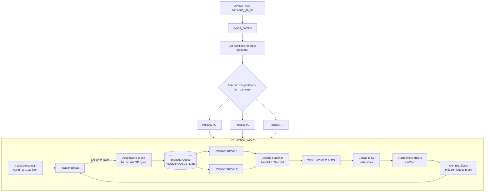

# Parallel Kafka → S3 Export

## Overview

In this project, I export CDC events from Kafka topics to S3 as Parquet in parallel to maximize throughput while keeping memory bounded. Each Airflow task runs `kafka_export.export_parallel(table, ds)`, which spawns **one process per Kafka partition** (capped by a local-machine limit) and processes partitions concurrently. Within each partition, I use a reader thread + bounded queue + multiple uploader threads to stream data efficiently without buffering entire partitions in memory.

## How It Works



## Key Mechanisms

### 1) Parallelism
- **Per-partition processes**: I use `concurrent.futures.ProcessPoolExecutor` to run each partition in its own process. This avoids GIL contention and isolates memory.
- **Fan-out cap**: Currently hard-coded to **1 pool/process set** in practice for local machine requirements (`min(partitions, ...)` capped conservatively). I can increase this when running on larger machines.
- **Independent progress**: Each partition tracks its own offsets and commits independently.

### 2) Memory Control (Prevent OOM)
To avoid loading entire partitions into RAM, I enforce multiple limits:

| Config | Default | Purpose |
| --- | --- | --- |
| `CHUNK_MAX_RECORDS` | `50000` | Stop accumulating a chunk after this many records. |
| `CHUNK_MAX_BYTES` | `32000000` (32 MB) | Stop accumulating a chunk after this many wire bytes (Kafka record bytes). |
| `QUEUE_SIZE` | `2` | Bounded queue between reader and uploaders. Reader blocks when full (backpressure). |
| `UPLOAD_WORKERS` | `2` | Number of uploader threads per partition to upload chunks concurrently. |
| `IDLE_TIMEOUT_MS` | `10000` | Stop polling if no new messages for this long (topic drained/idle). |

**Peak memory estimate (per partition):** roughly `(QUEUE_SIZE + UPLOAD_WORKERS + 1) × CHUNK_MAX_BYTES`. With defaults that's ~5 × 32 MB ≈ 160 MB per partition process.

### 3) Numeric Decoding
Debezium serializes `NUMERIC/DECIMAL` as base64. Before writing Parquet, I decode them via `decode_numerics()` to proper `Decimal` values (see `docs/Kafka-Debezium.md`).

### 4) Parquet Output
Each chunk is written as:
```
s3://<bucket>/<table>/load_date=<ds>/<table>-p<partition>-o<start>-<end>.parquet
```
Including offset range makes retries idempotent (re-uploading overwrites the same object).

### 5) Offset Management (Manual Commit After S3 Landing)
- **Read**: Consumer assigned to single partition, tracks current offsets.
- **Buffer**: Reader accumulates until limits hit → enqueues chunk with `(start_offset, end_offset)`.
- **Upload**: Uploader threads write chunk to S3. Only on **success** do I record the chunk as "landed".
- **Commit**: I commit Kafka offsets **only for the contiguous prefix**. If chunk N fails after partial uploads, I do **not** commit past chunk N-1. On retry of the same partition/task run, I resume from the last committed offset.
- **At-least-once**: This guarantees no data loss; retries may overwrite same Parquet objects but downstream MERGE is deduped by `__source_ts_ms`.

### 6) Conflict Handling
- **Partition-level isolation**: Each partition is processed by its own process. Kafka partitions are the unit of parallelism and ordering; I don't process the same partition concurrently across processes.
- **Offset-based safety**: Committing only contiguous prefix prevents skipping uncommitted data.
- **Idempotent writes**: S3 keys include offset ranges, so re-running doesn't create conflicting "new" files for the same range.
- **No cross-partition conflicts**: Tables are partitioned independently; no shared mutable state between partitions.

### 7) Failure Handling
- **Retry with backoff**: S3 uploads retry with exponential backoff (`UPLOAD_BACKOFF_BASE_S * 2^attempt`) up to `UPLOAD_MAX_RETRIES`.
- **Chunk-level failure**: If a chunk exhausts retries, the task fails without committing beyond the last successful contiguous chunk.
- **Process isolation**: A failure in one partition process doesn't necessarily corrupt others (depends on executor behavior).
- **Resumable**: Since offsets are only committed on successful landing, re-triggering the DAG for the same `ds`/partition range will resume from last committed offset.

## Configuration

Editable via environment variables:

| Variable | Default | Notes |
| --- | --- | --- |
| `CHUNK_MAX_RECORDS` | `50000` | Lower for slower networks/smaller memory |
| `CHUNK_MAX_BYTES` | `32000000` | Lower to be safer on constrained machines |
| `QUEUE_SIZE` | `2` | Increase cautiously; larger = more memory buffering |
| `UPLOAD_WORKERS` | `2` | Increase if S3 upload bandwidth is underutilized |
| `UPLOAD_MAX_RETRIES` | `5` | Tune based on S3 reliability |
| `UPLOAD_BACKOFF_BASE_S` | `1` | Exponential backoff base |
| `IDLE_TIMEOUT_MS` | `10000` | Time to consider topic idle and stop |

## Section: Notes & Points To Improve

- **Hard-coded parallelism cap**: Currently limited to **1 pool/fan-out** for local machine requirements. Should make this configurable (e.g., `KAFKA_EXPORT_MAX_PROCESSES`) and scale based on CPU/memory.
- **Connector config coupling**: Partition count depends on Kafka topic configuration. Need to handle repartitioning if topics change.
- **Memory tuning**: The `(queue + workers + 1) * chunk_bytes` estimate should be validated per environment and ideally enforced with monitoring.
- **Error visibility**: Add better per-chunk logging (partition, offsets, bytes, duration) to debug failures faster.
- **Exactly-once vs at-least-once**: Currently at-least-once. If stricter exactly-once is needed, consider idempotent writes + deduplication keys at the target (Snowflake MERGE already dedupes by `__source_ts_ms`).
- **S3 multipart/uploads**: For very large chunks, consider explicit multipart uploads with retry per part.
- **Backpressure tuning**: `QUEUE_SIZE` and `UPLOAD_WORKERS` need balancing; too small causes idle readers, too large causes memory spikes.
- **Local dev vs prod**: Provide profiles (dev/prod) to auto-tune chunk sizes/parallelism instead of editing env manually.
- **Offset commit granularity**: Only contiguous prefix is committed (correct). Could add metrics on "lag" per partition.
- **Schema evolution**: Handle new columns/types gracefully as Debezium evolves schemas over time.
